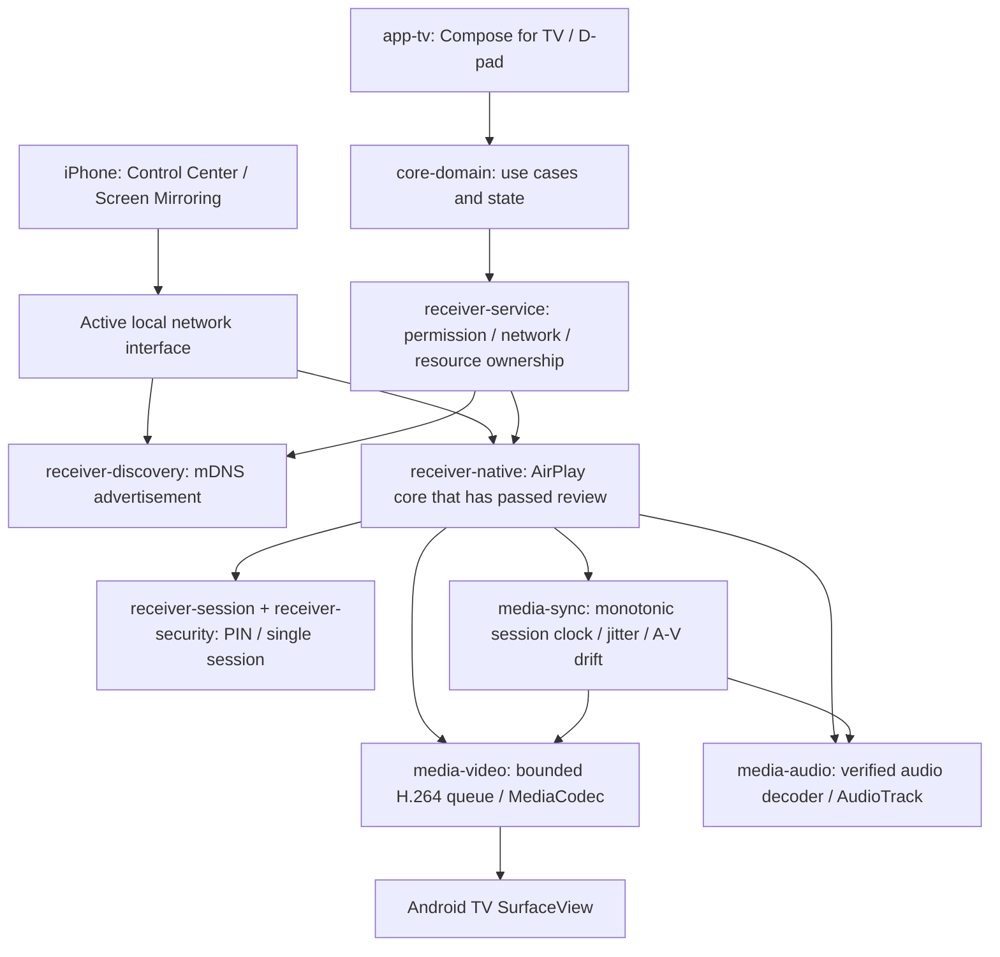

# Android TV receiver architecture design

Design status: not implemented; no protocol dependency selected. The target is only iPhone system AirPlay mirroring → Android TV. The modules described here should not be treated as application code that has been built.

## Data path

mDNS shows the receiver in the list; on its own it does not provide real mirroring. Discovery is advertised only when permission, network, listener and verified protocol capabilities are ready. Features that do not work are not offered to the iPhone through fake TXT capabilities. Unsupported protocol steps are not written into production by guesswork.

## Ownership and boundaries

| Owner | Owned resource / shutdown |
|---|---|
| ReceiverService | Session scope, network callback, foreground notification; idempotent shutdown on stop |
| Discovery component | Advertisement only on the active Ethernet/Wi-Fi; unregister and release of the multicast lock on permission/network loss |
| Session component | Single active sender, bounded request/parser and timeout; a second sender cannot take over automatically |
| Security component | SecureRandom PIN, rate limiting and Keystore identity; the session key is cleared on shutdown |
| Native adapter | Socket/byte buffer ownership and the JNI callback contract; a callback does not block the UI thread |
| Video component | Hardware MediaCodec and bounded frame queues; controlled stop/recreate on Surface loss |
| Audio component | Codec, AudioTrack and audio focus; invalid PCM is safely muted |
| Sync component | Conversion from the sender clock to the monotonic clock; bounded jitter buffer and measured drift |
| Diagnostics | Bounded local ring buffer and counters; contains no media/PIN/key |

The UI receives neither native callbacks nor media byte arrays. It shows state through StateFlow/use cases. The domain does not depend on Android framework classes. The presence of an Android `Uri` in the specification's `DiagnosticsRepository` example contradicts this principle; in the implementation the URI will be held in the platform adapter, and the domain will be given a platform-independent export target.

## Permission and state flow

Start → permission check → active local network check → protocol listener → advertisement → ready → PIN → authentication → negotiation → live video/audio. Permission denial or revocation is not an exception for continuing to advertise/open sockets; resources are released and the permission state is shown to the user.

Background ready standby is off by default. If the user enables it, the foreground service rules of the Android version apply; no boot/start trick that bypasses platform restrictions is performed. If the user turns the receiver off, it does not turn itself back on automatically.

PIN is on by default; adding a trusted device happens only through the TV user's explicit selection after a successfully authenticated connection. Not everyone on the same network is considered trusted. Binding to an open Wi-Fi/LAN address does not by itself prove the WAN prohibition; address/interface policy and controlled external network attempts are verified separately.

At startup, hardware capabilities are taken from a real MediaCodecList query. H.264 → SurfaceView is the baseline path; audio is delivered to AudioTrack with AAC-ELD/AAC-LC and the required ALAC format. Audio/video is not synchronized to wall clock. Queue size, recovery count and wait duration cannot be unbounded. Exact buffer values will be chosen by real spike measurement; performance was not invented at this stage.

In this first application, an iPhone sender application, HLS/URL playback, recording, remote control, Cast, Miracast or any other platform interface will not be developed.
