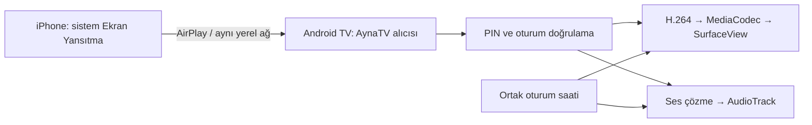

# Etkin ürün kapsamı

Kullanıcının 31 Ağustos 2026 tarihli açıklaması ana şartnamenin geniş platform ifadelerinden önceliklidir.

- **Kurulan uygulama:** yalnız Android TV üzerinde AynaTV Receiver.
- **Gönderici:** iPhone; iPhone için uygulama, uzantı veya yardımcı servis geliştirilmeyecek.
- **Bağlantı:** iPhone Denetim Merkezi → Ekran Yansıtma → TV alıcısı → TV'deki PIN → canlı ekran ve desteklenen ses.
- **Protokol:** AirPlay ekran yansıtma alıcısı; sender SDK veya Google Cast bu ihtiyacın yerine geçmez.
- **Ağ:** aynı yerel ağ; bulut, hesap, internet üzerinden röle, kayıt, reklam ve telemetri yok.
- **Video:** H.264 → MediaCodec donanım çözme → SurfaceView; 720p30, 1080p30, referans donanımda 1080p60.
- **Ses:** gerekli AAC-ELD/AAC-LC/ALAC yolu → AudioTrack; ortak oturum saati ve A/V senkronu.
- **Kullanım:** Android TV launcher ve D-pad; dokunmatik ekran gereksinimi yok.
- **Güvenlik:** PIN varsayılan açık; yerel ağ güvenilir sayılmaz; DRM koruması aşılmaz.

Google TV veya Fire TV için ayrı ürün, uyumluluk iddiası veya test hedefi yoktur. iPad/macOS göndericileri, Android telefon/tablet alıcısı, masaüstü alıcıları ve Cast/Miracast/DLNA bu işte uygulanmaz. Şartnamedeki P1 ek medya türleri ilk hedefe eklenmez.

AirPlay burada teknik protokol tanımıdır; Apple onayı veya marka kullanım izni beyanı değildir. Lisans/köken incelemesi ve fiziksel iPhone → Android TV kanıtı olmadan çekirdek seçimi tamamlanamaz. Ana şartnamenin 5, 42 ve 45. bölümlerindeki kapılar korunur.
